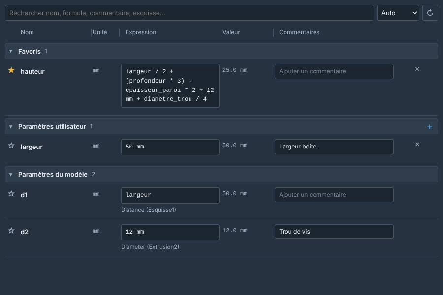
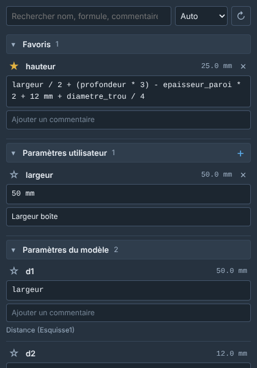

# Quick Parameters for Autodesk Fusion

*[Français plus bas](#français)*

A dockable, non-modal palette to view, edit, add and delete your Fusion parameters without opening the *Change Parameters* dialog. It stays open while you work.



> Previews are renderings of the palette with sample data, not Fusion screenshots.

## Features

- **Same sections as Fusion's own dialog**: Favorites, User Parameters, Model Parameters. When the palette is wide, it switches to a table with resizable columns (drag a column border; double-click resets it).
- **Long formulas stay readable**: the formula field uses the full width, wraps and grows.
- **Search** by name, formula, comment, value, unit, type (for example *Distance*) or the sketch or feature that created the parameter.
- **Edit expressions and comments.** Press Enter to apply, Esc to cancel.
- **Formula autocomplete**: suggestions for your parameters (with their value), Fusion functions and units as you type. Press Ctrl+Space to open the list at any time.
- **Rename parameters**: double-click the name, or press F2.
- **Favorites are Fusion's own**, so they are shared with the built-in dialog.
- **Add and delete user parameters.** Deleting a parameter that is in use is refused with a clear message.
- **Clear error messages** for incorrect formulas: unknown name, unbalanced parentheses, a parameter referring to itself, invalid name.
- **Follows the Fusion interface theme** (light or dark).
- **Eight languages**: English, French, German, Spanish, Italian, Portuguese, Japanese, Chinese. Automatic by default, or choose from the selector.

## Installation

Windows only.

**From the Autodesk App Store**: install the add-in from its App Store page, then restart Fusion.

**Manually**

1. Download `NonModalParameters.bundle.zip` from the [Releases](../../releases) page and extract it.
2. Copy the `NonModalParameters.bundle` folder to `%APPDATA%\Autodesk\ApplicationPlugins\`.
3. Restart Fusion.

## Usage

1. Open a design and click **Quick Parameters** in **SOLID › MODIFY**.
2. Edit a formula or a comment. Enter applies it, Esc cancels it. While typing a formula, use Up/Down and Enter (or Tab) to pick a suggestion.
3. Click **+** in the *User Parameters* header to add a parameter. Click **✕**, then **Confirm**, to delete one.
4. Click ☆ to add a parameter to your favorites.

The palette refreshes when you return to it or switch documents. The **↻** button forces a refresh.

## Settings and privacy

The add-in does not use the network. It stores only your language choice and column widths in `%APPDATA%\NonModalParameters\settings.json`. Delete this folder to reset them.

## Uninstall

Delete the `NonModalParameters.bundle` folder from `%APPDATA%\Autodesk\ApplicationPlugins\`, then restart Fusion.

## Support

Report bugs or suggest features in [Issues](../../issues). Please include your Fusion version, your Windows version and, for a rejected formula, the formula itself.

## Development

The add-in is a Python script with an HTML palette: `NonModalParameters.bundle/Contents/NonModalParameters/`. To check the bundle structure before publishing:

```
python tools/check_bundle.py NonModalParameters.bundle
```

## License

[MIT](LICENSE)

---

## Français

Une palette ancrable et non modale pour consulter, modifier, ajouter et supprimer vos paramètres Fusion sans ouvrir la boîte *Modifier les paramètres*. Elle reste ouverte pendant que vous travaillez.



> Les aperçus sont des rendus de la palette avec des données d'exemple, pas des captures de Fusion.

### Fonctionnalités

- **Mêmes sections que la fenêtre de Fusion** : Favoris, Paramètres utilisateur, Paramètres du modèle. Quand la palette est large, elle passe en tableau à colonnes redimensionnables (glissez une bordure de colonne ; un double-clic la réinitialise).
- **Formules longues lisibles** : le champ de formule occupe toute la largeur, passe à la ligne et s'agrandit.
- **Recherche** par nom, formule, commentaire, valeur, unité, type (par exemple *Distance*) ou esquisse / fonction qui a créé le paramètre.
- **Modification des formules et des commentaires.** Entrée applique, Échap annule.
- **Autocomplétion des formules** : suggestions de vos paramètres (avec leur valeur), des fonctions et des unités de Fusion pendant la saisie. Ctrl+Espace ouvre la liste à tout moment.
- **Renommer un paramètre** : double-clic sur son nom, ou touche F2.
- **Favoris natifs de Fusion**, donc partagés avec la fenêtre intégrée.
- **Ajout et suppression de paramètres utilisateur.** La suppression d'un paramètre utilisé est refusée avec un message clair.
- **Messages d'erreur explicites** pour les formules incorrectes : nom inconnu, parenthèses non appariées, paramètre qui se référence lui-même, nom invalide.
- **Suit le thème de l'interface Fusion** (clair ou sombre).
- **Huit langues** : anglais, français, allemand, espagnol, italien, portugais, japonais, chinois. Automatique par défaut, ou au choix avec le sélecteur.

### Installation

Windows uniquement.

**Depuis l'Autodesk App Store** : installez le complément depuis sa page, puis redémarrez Fusion.

**Manuellement**

1. Téléchargez `NonModalParameters.bundle.zip` depuis la page [Releases](../../releases) et extrayez-le.
2. Copiez le dossier `NonModalParameters.bundle` dans `%APPDATA%\Autodesk\ApplicationPlugins\`.
3. Redémarrez Fusion.

### Utilisation

1. Ouvrez un design et cliquez sur **Paramètres rapides** dans **SOLIDE › MODIFIER**.
2. Modifiez une formule ou un commentaire. Entrée l'applique, Échap l'annule. Pendant la saisie d'une formule, choisissez une suggestion avec les flèches haut/bas puis Entrée (ou Tab).
3. Cliquez sur **+** dans l'en-tête *Paramètres utilisateur* pour ajouter un paramètre. Cliquez sur **✕**, puis **Confirmer**, pour en supprimer un.
4. Cliquez sur ☆ pour ajouter un paramètre à vos favoris.

La palette se rafraîchit quand vous y revenez ou changez de document. Le bouton **↻** force l'actualisation.

### Réglages et confidentialité

Le complément n'utilise pas le réseau. Il enregistre seulement votre choix de langue et les largeurs de colonnes dans `%APPDATA%\NonModalParameters\settings.json`. Supprimez ce dossier pour les réinitialiser.

### Désinstallation

Supprimez le dossier `NonModalParameters.bundle` de `%APPDATA%\Autodesk\ApplicationPlugins\`, puis redémarrez Fusion.

### Assistance

Signalez les bugs ou proposez des fonctionnalités dans [Issues](../../issues). Indiquez votre version de Fusion, votre version de Windows et, pour une formule refusée, la formule elle-même.

### Licence

[MIT](LICENSE)
